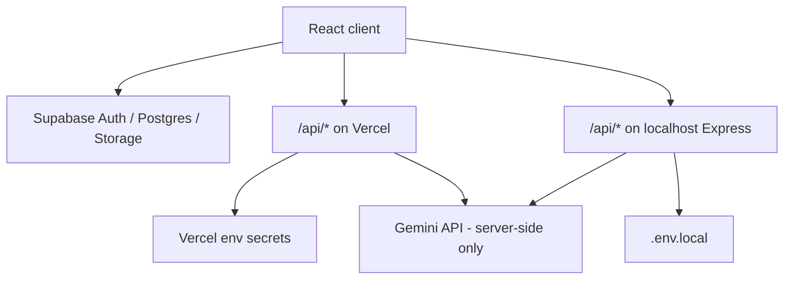

# API routing matrix (Vercel · Express · Supabase)

Canonical reference for **which runtime handles each capability**. Từ 2026-06, **tất cả path và logic đều thống nhất** — không có sự khác biệt giữa Express (local dev) và Vercel (production). Business logic nằm trong `_server-lib/`, route handlers là thin wrappers.

## Quick reference

| Capability | Vercel (`api/`) | Express (`server/routes/`) | Shared logic |
|------------|-----------------|---------------------------|--------------|
| Public config (Supabase keys) | `GET /api/config` → `api/config.ts` | `server/routes/config.ts` | Inline (env vars only) |
| **Gemini CV analysis** (chấm điểm, sync) | `POST /api/analyze` → `api/analyze.ts` (maxDuration 300s làm trần an toàn, deadline nội bộ 65s) | `POST /api/analyze` → `server/routes/analyze.ts` | `_server-lib/analyze/handler.ts` |
| **Gemini CV rewrite** (nền, `fullRewrittenCV`) | `POST /api/rewrite-cv` → `api/rewrite-cv.ts` (maxDuration 300s, deadline 65s) | `POST /api/rewrite-cv` → `server/routes/rewriteCv.ts` | `_server-lib/rewriteCv/handler.ts` |
| **Gemini CV parse** (nền, `parsedCV`) | `POST /api/parse-cv` → `api/parse-cv.ts` (maxDuration 300s, deadline 65s) | `POST /api/parse-cv` → `server/routes/parseCv.ts` | `_server-lib/parseCv/handler.ts` |
| PDF text extract | `POST /api/extract-pdf` → `api/extract-pdf.ts` (Auth: Bearer or reCAPTCHA) | `POST /api/extract-pdf` → `server/routes/pdf.ts` (idem) | `_server-lib/pdf/handler.ts` |
| reCAPTCHA verify | Không còn route riêng — verify inline trong handler dùng nó (extract-pdf, feedback) | — | `_server-lib/recaptcha.ts` |
| Feedback email | `POST /api/send-email` (`type:'feedback'`) → `api/send-email.ts` | `POST /api/send-feedback` → `server/routes/feedback.ts` | `_server-lib/email/handlers.ts` |
| Welcome email (cần `Authorization: Bearer`; chỉ gửi tới email của user trong token) | `POST /api/send-email` (`type:'welcome'`) → `api/send-email.ts` | `POST /api/send-welcome-email` → `server/routes/welcomeEmail.ts` | `_server-lib/email/handlers.ts` |
| VIP upgrade email | server-side via `_server-lib/payment/vipUpgradeEmail.ts` | — | — |
| PayOS — tạo link (≤5 đơn pending/15 phút) | `POST /api/payment/create` → `api/payment.ts` (unified) | `POST /api/payment/create` → `server/routes/payment.ts` | `_server-lib/payment/handlers.ts` |
| PayOS — webhook | `POST /api/payment/webhook` → `api/payment.ts` | `POST /api/payment/webhook` → `server/routes/payment.ts` | `_server-lib/payment/handlers.ts` |
| PayOS — confirm (fallback) | `POST /api/payment/confirm` → `api/payment.ts` | `POST /api/payment/confirm` → `server/routes/payment.ts` | `_server-lib/payment/handlers.ts` |
| Admin — đổi role / plan | `POST /api/admin/set-user-role`, `/api/admin/set-user-plan` → `api/admin.ts` (unified, Bearer + role=admin) | `server/routes/admin.ts` | RPC `set_user_role` / `admin_set_user_plan` |
| Admin — xoá user (hard delete) | `POST /api/admin/delete-user` → `api/admin.ts` | `POST /api/admin/delete-user` → `server/routes/admin.ts` | `_server-lib/admin/deleteUser.ts` (xoá `auth.users` → cascade profiles/history; dọn storage `cv-files`, `cv-analyze-tmp`; chặn xoá admin/chính mình) |
| Recruiter — lưu phân tích | `POST /api/recruiter/save-analysis` → `api/recruiter/save-analysis.ts` | `POST /api/recruiter/save-analysis` → `server/routes/recruiter.ts` | Inline (RPC call) |

Rewrites are defined in [`vercel.json`](../vercel.json).

**PayOS:** `POST /api/payment/create` yêu cầu `Authorization: Bearer <supabase_access_token>` (JWT được cache 5 phút in-memory). Webhook không dùng JWT; xác thực 2 lớp — HMAC-SHA256 + timestamp freshness (±30 phút, `transactionDateTime` UTC+7) để chống replay attack. Biến môi trường: `PAYOS_CLIENT_ID`, `PAYOS_API_KEY`, `PAYOS_CHECKSUM_KEY`, `SUPABASE_SERVICE_ROLE_KEY`, `APP_URL`.

**Recruiter save-analysis:** `POST /api/recruiter/save-analysis` yêu cầu `Authorization: Bearer <supabase_access_token>`. Dùng service role để ghi kết quả phân tích vào bảng recruiter campaigns.

**Chấm điểm canonical (Stage 3.7):** `/api/analyze` luôn chấm bằng prompt EN (độc lập ngôn ngữ UI, `scoreVersion = canonical-en-v1`); UI tiếng Việt thêm một bước dịch riêng chỉ cho văn bản trình bày. Chi tiết: [12_canonical_scoring.md](./12_canonical_scoring.md).

**Deadline (Stage 3.5):** `/api/analyze`, `/api/rewrite-cv`, `/api/parse-cv` dùng chung một request deadline 65s (`_server-lib/deadline.ts`) tính từ đầu handler. Storage (≤15s/ref, hủy thật qua AbortSignal), Gemini (deadline AI = 65s − 6s dự phòng, hủy thật), quota và `analysis_log` đều bị giới hạn bởi phần còn lại, nên server trả JSON trước khi client (75s) bỏ cuộc. `maxDuration: 300` (Hobby + Fluid Compute đã xác minh) chỉ là trần an toàn, không phải ngân sách request. Chi tiết: [5_api.md](./5_api.md).

## Request flow (high level)

> **SEC-4 (2026-06):** Gemini không còn được gọi trực tiếp từ browser. `GEMINI_API_KEY` chỉ tồn tại trên server. Frontend gửi `POST /api/analyze` → backend xử lý toàn bộ AI call.

## When to use which stack

### Vercel serverless (`api/*.ts`)

- **Production** deployment on Vercel.
- Same URL shape as the app (`/api/...`); `vercel.json` maps sources to handler files.
- Use for secrets that must not ship in the client bundle (Resend, reCAPTCHA server verify, PDF parsing on server).

### Express (`npm start` → `server.ts` + `server/routes/`)

- **Local development** full-stack: Vite dev server proxies or hits Express for `/api`.
- **Paths và behavior giống hệt Vercel** — cả hai gọi cùng `_server-lib/` handlers.
- Rate limiting: Express dùng `server/lib/rateLimiter.ts`; ngoài ra cả Vercel và Express dùng bộ đếm chung Postgres `consume_api_rate_limit` qua `_server-lib/rateLimit.ts` (migration `20261101100000`) cho `extract-pdf`, `storage`, `send-email`.

### Supabase Edge Functions — không còn

Từ 2026-10-31 (audit §4.10), project không còn Edge Function nào và repo không còn `supabase/functions/`. `extract-pdf`, `verify-recaptcha` và `send-email` (deploy cũ) đã bị xoá; client không dùng `supabase.functions.invoke`. Mọi luồng đi qua `/api/*` (Vercel) hoặc Express, dùng chung `_server-lib/`.

Do **not** assume an Edge function replaces Express and Vercel handlers — kiểm tra call sites trước khi thêm mới.

## Supabase data plane (not HTTP `/api`)

| Concern | Client module | Notes |
|---------|---------------|--------|
| Auth | `src/lib/supabase.ts` + `src/context/AuthContext.tsx` | Google OAuth + Email/Password (Supabase Auth); không có verify endpoint reCAPTCHA riêng — reCAPTCHA v3 chỉ dùng inline cho feedback/extract-pdf |
| History / saved JDs | `src/services/historyService.ts` | Postgres via Supabase client |
| Storage bucket `cv-files` | Supabase Storage API | Kho CV vĩnh viễn — upload/download/delete qua `src/services/cvService.ts` |
| Storage bucket `cv-analyze-tmp` (2026-07) | `src/services/cvService.ts` (`uploadTempAnalysisFile`/`cleanupTempAnalysisFiles`), server `_server-lib/storage/tempFile.ts` (`resolveStorageRef`) | File tạm 2–15MB trong luồng phân tích, client tự xoá sau khi analyze/rewrite/parse-cv xong |

## Adding a new endpoint

1. Implement **shared handler** in `_server-lib/<module>/handler.ts` — tất cả business logic ở đây.
2. Add **Vercel** thin wrapper under `api/` (unpack headers/body → call handler → return result).
3. Add **Express** thin wrapper under `server/routes/` (mount on router, same pattern).
4. Add **rewrite** in `vercel.json` if the path is new.
5. Update this matrix and [`docs/5_api.md`](./5_api.md).

## Out of scope (this doc)

- Merging `api/` and `server/` into a single deployable.
- Changing analyze or auth behavior.

## Cập nhật storage R2 (2026-10-18)

Các mô tả Supabase Storage ở trên là luồng legacy. Tích hợp mới giữ Supabase làm nơi upload mặc định và đọc theo metadata; có thể bật R2 riêng cho `temp`, `saved`, `candidate` qua cấu hình server. File tạm R2 dùng reference `r2:{uploadId}`, file lâu dài giữ `file_path` cùng `storage_provider`. Tải file cá nhân/recruiter qua `POST /api/storage` với JWT, không dùng public URL. Cleanup có queue bền vững và scheduler, kể cả khi xoá campaign/user. Xem [10_storage_r2.md](10_storage_r2.md) cho migration bắt buộc, API, CORS/lifecycle, kiểm thử và rollback.

| Route bổ sung | Vercel | Express |
| --- | --- | --- |
| `POST /api/storage` | `api/extract-pdf.ts?resource=storage` (dùng chung function PDF; vẫn tổng 9 handler) | `server/routes/storage.ts` |
| `GET /api/storage?action=cleanup` | Cùng function, Bearer cleanup secret riêng | Cùng router |
